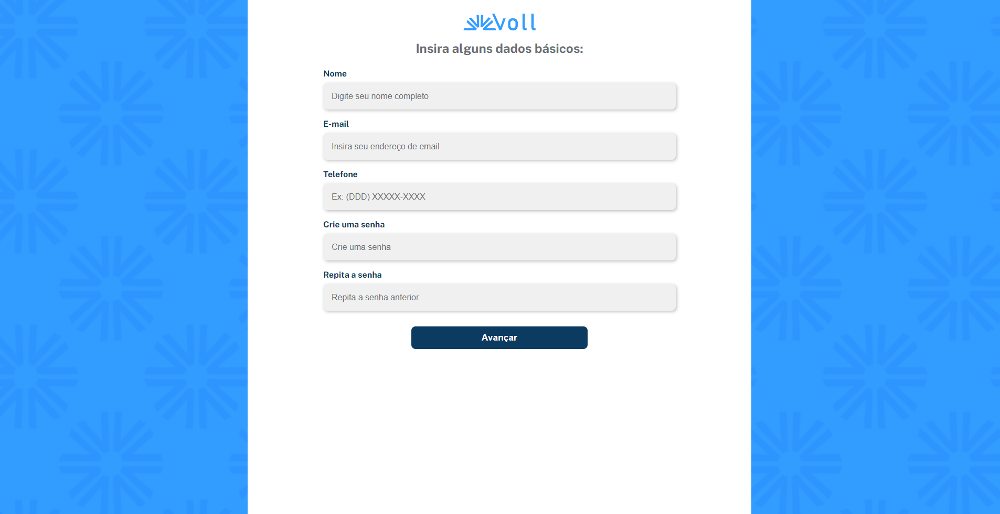

# Voll

Multi-step signup form built with React Hook Form and TypeScript, featuring custom validation, input masks, and address autofill via the ViaCEP API.



## 📖 About

Voll Med is a clinic that connects the right professionals to its patients. The company is developing its website and app, which will have a large number of features, and forms are a key part of them: patient data needs to be validated before it is submitted.

This project focuses on building those forms with React Hook Form and TypeScript, handling validation, error messages, and a better user experience.

## 🔨 Features

- Patient registration form, split into two steps (personal data and address)
- Field validation with clear error messages (required fields, minimum length, format)
- Password confirmation, checked against the first password field
- Phone number input with a mask
- Address autofill from the ZIP code (CEP) using the ViaCEP API, with an error shown for invalid ZIP codes
- Type-safe form data with TypeScript

The design is available on [Figma](https://www.figma.com/file/hsW25fAq36IDzzIxBtpgCd/Voll.med-%7C-React-Hook-Forms?type=design&node-id=57-1388&mode=design).

## 🛠️ Tech Stack

- **React 18**: UI library
- **Vite**: build tool and dev server
- **TypeScript**: static typing
- **React Hook Form**: form state and validation
- **react-input-mask**: input masks (phone number)
- **Styled Components**: styling
- **ViaCEP API**: address lookup by ZIP code
- **ESLint**: linting
- **Figma**: project design and prototype

## 🚀 Getting Started

### Prerequisites

- Node.js (version 20.10.0 was used in the course)
- npm

### Installation

```bash
# Clone the repository
git clone https://github.com/DanielGranato/react-hook-form-multistep-signup.git

# Navigate into the project folder
cd <repo-name>

# Install dependencies
npm install
```

### Running locally

```bash
npm run dev
```

## 🎯 Learning Objectives

This project was built to practice:

- Managing forms with `useForm` and `register`
- Validating fields with built-in rules and custom `validate` functions
- Comparing fields with `watch` (password confirmation)
- Integrating components that need `Controller` (masked input)
- Setting values and errors programmatically with `setValue`, `setError`, and `clearErrors`
- Typing form data with TypeScript interfaces
- Fetching data from an external API (ViaCEP) and handling request errors

